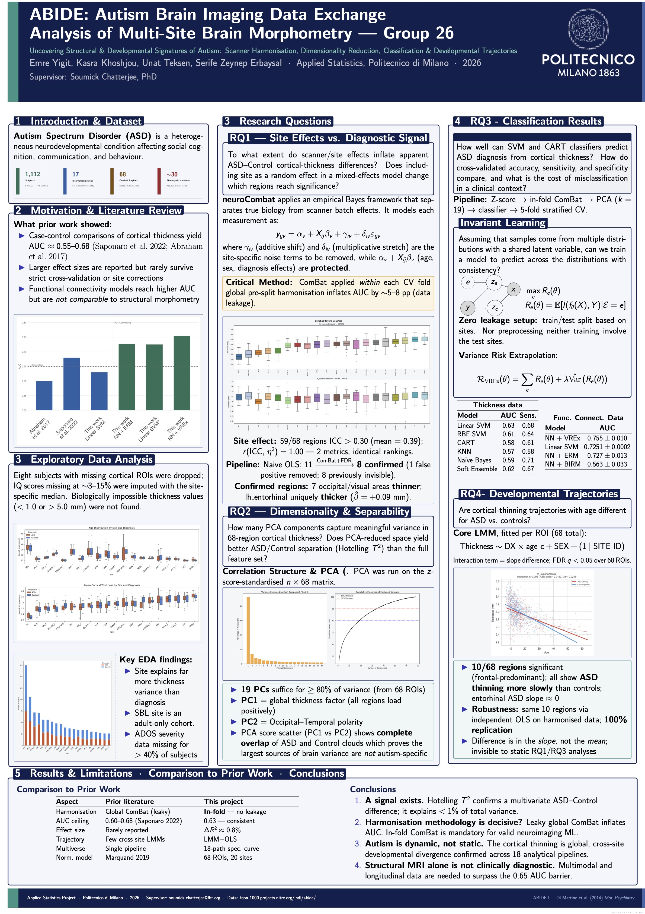

# ABIDE: Autism Brain Imaging Data Exchange
### Analysis of Multi-Site Brain Morphometry (Group 26)
*Uncovering Structural & Developmental Signatures of Autism: Scanner Harmonisation, Dimensionality Reduction, Classification & Developmental Trajectories*

**Applied Statistics** — Politecnico di Milano, 2026  
**Supervisor:** Soumick Chatterjee, PhD  

---

## Group Members

* **Emre Yiğit**
* **Kasra Khoshjou**
* **Unat Tekşen**
* **Şerife Zeynep Erbaysal**

---

## Project Poster



> A full-resolution vector version of the presentation poster is available here: [AppliedStatistics_Group26_Poster.pdf](./AppliedStatistics_Group26_Poster.pdf).

---

## 1. Project Aim & Scientific Premise

Autism Spectrum Disorder (ASD) is a complex, heterogeneous neurodevelopmental condition characterized by altered social communication, atypical sensory processing, and restricted, repetitive behaviors. Despite decades of neuroimaging research, structural Magnetic Resonance Imaging (sMRI) findings have remained notoriously contradictory: reported anatomical effect sizes are frequently modest and rarely survive rigorous cross-validation or cross-site replication.

The overarching aim of this project is to investigate whether structural brain morphometry—specifically **cortical thickness across 68 anatomical regions**—contains robust, replicable, and clinically meaningful biomarkers of ASD. Rather than conducting naive cross-sectional comparisons, we address fundamental methodological challenges in multi-site neuroimaging:

1. **Disentangling Scanner Noise from Biology:** Determine how multi-site acquisition protocols (scanner manufacturer, magnetic field strength, head coils) distort cortical measurements, and isolate genuine diagnostic signals using empirical Bayes harmonisation.
2. **Compressing Morphological Redundancy:** Quantify the true underlying dimensionality of cortical thickness and evaluate whether unsupervised clustering can uncover discrete ASD neuro-subtypes aligned with clinical symptom severity (ADOS).
3. **Evaluating Diagnostic Prediction with Strict Leakage Control:** Measure whether machine learning classifiers can predict an ASD diagnosis from structural features when batch-correction parameters are isolated within strict cross-validation folds.
4. **Shifting from Static Snapshots to Developmental Trajectories:** Test the paradigm that autism is characterized not by static, time-invariant regional differences in cortical thickness, but by an altered rate of brain maturation (cortical thinning velocity) across the lifespan.

---

## 2. Dataset & Citation

This study utilizes structural morphometry data and phenotypic evaluations from the **Autism Brain Imaging Data Exchange I (ABIDE I)**.

### Dataset Overview
* **Sample Size:** 1,112 total participants (539 individuals diagnosed with ASD, 573 neurotypical Controls). After data cleaning and complete-case filtering across regions, the primary harmonisation cohort consists of 1,027 subjects.
* **Sites:** 17–20 international acquisition sites (e.g., NYU, USM, UCLA, PITT, KKI, OHSU, YALE, SBL).
* **Brain Morphometry:** High-resolution 3D T1-weighted structural MRI processed via the standard FreeSurfer cortical reconstruction pipeline. Cortical thickness (in mm) was extracted across **68 Regions of Interest (ROIs)** defined by the Desikan-Killiany atlas (34 bilateral regions).
* **Phenotypic Variables:** ~30 phenotypic variables, including chronological age (spanning 6.5 to 64 years), biological sex, IQ scores (Full-Scale IQ, Verbal IQ, Performance IQ), and diagnostic assessments including the Autism Diagnostic Observation Schedule (ADOS) and Autism Diagnostic Interview-Revised (ADI-R).

### Quality Control & Preprocessing
* Eight subjects with missing cortical ROI measurements were removed.
* Missing IQ values (~3–15% across cohorts) were imputed using site-specific medians to preserve multi-site balance.
* Inspection confirmed that all cortical thickness values fell within biologically plausible ranges ($1.0\text{ mm} \le \text{thickness} \le 5.0\text{ mm}$).
* Exploratory data analysis (EDA) revealed critical structural properties:
  - Scanner/site membership accounted for vastly more variance than diagnostic status.
  - SBL is an adult-only cohort, while others (e.g., KKI) focus exclusively on pediatric cohorts.
  - Clinical symptom severity (ADOS) was missing for $>40\%$ of subjects, requiring targeted sub-cohort analyses for severity alignment.

### Citation
When citing the primary ABIDE I dataset:

> Di Martino, A., Yan, C. G., Li, Q., Denio, E., Castellanos, F. X., Alaerts, K., Anderson, J. S., Assaf, M., Bookheimer, S. Y., Dapretto, M., Deucy, B. M., Fair, D. A., Fleisher, P. T., Gao, J. H., Groen, W. I., Hahn, A., Humphreys, K., Morrow, E. M., O’Hearn, K., Pelphrey, K. A., Shen, M. D., Vogel, S. C., Walter, C., Walkup, J. T., Washington, S., Webb, S. J., Wheeler, P., Wolf, J. M., Wiggins, J. L., Milham, M. P. (2014). **The Autism Brain Imaging Data Exchange: Towards a Large-Scale Evaluation of the Intrinsic Brain Architecture in Autism.** *Molecular Psychiatry*, 19(6), 659–667.  
> DOI: [10.1038/mp.2013.78](https://doi.org/10.1038/mp.2013.78)  
> Repository: [ABIDE I on NITRC](http://fcon_1000.projects.nitrc.org/indi/abide/)

---

## 3. Research Questions, Methodologies & Findings

### Research Question 1 (RQ1): Scanner / Site Effects vs. Diagnostic Signal

#### The Question
*To what extent do scanner and acquisition site variations inflate or suppress apparent ASD–Control cortical-thickness differences? Does controlling for site as a random effect in a mixed-effects model or via empirical Bayes harmonisation alter which cortical regions reach statistical significance?*

#### Methodology
1. **Site Effect Quantification:**
   - **Intraclass Correlation Coefficient $\text{ICC}(1)$:** Evaluated the proportion of variance attributable to scanner hardware rather than subject biology using a one-way random effects ANOVA framework:
     $$\text{ICC}(1) = \frac{\text{MS}_{\text{between}} - \text{MS}_{\text{within}}}{\text{MS}_{\text{between}} + (n_0 - 1)\text{MS}_{\text{within}}}$$
   - **One-Way ANOVA ($\eta^2$):** Calculated the variance explained by site per region ($\eta^2 = \text{SS}_{\text{between}} / \text{SS}_{\text{total}}$).
2. **Empirical Bayes Harmonisation (neuroCombat):**
   - Modeled cortical thickness as:
     $$y_{ijv} = \alpha_v + X_{ij}\beta_v + \gamma_{iv} + \delta_{iv}\varepsilon_{ijv}$$
     where $\gamma_{iv}$ (additive location shift) and $\delta_{iv}$ (multiplicative scale stretch) are site-specific scanner parameters estimated via empirical Bayes shrinkage, while $\alpha_v + X_{ij}\beta_v$ protects biological covariates (Diagnosis, Age, Sex).
3. **Tri-Model Comparative Framework:**
   - **Model A (Naive OLS):** $\text{Thickness} \sim \text{DX} + \text{Age} + \text{Sex}$ (no site control).
   - **Model B1 (ComBat + OLS):** Identical linear model fitted on ComBat-harmonised residuals.
   - **Model B2 (Linear Mixed-Effects Model - LMM):** $\text{Thickness} \sim \text{DX} + \text{Age} + \text{Sex} + (1 | \text{SITE\_ID})$ fitted via REML.
4. **Multiple Testing Correction:** Benjamini–Hochberg False Discovery Rate (FDR, $q < 0.05$) across all 68 ROIs.

#### What We Found
* **Massive Site Contamination:** 59 of 68 cortical regions exhibited $\text{ICC} > 0.30$ (mean $\text{ICC} = 0.39$), with the left superior temporal gyrus reaching $\text{ICC} = 0.569$ (56.9% scanner artifact). Pearson correlation between $\text{ICC}$ and $\eta^2$ was $r = 1.00$ ($p = 1.1 \times 10^{-142}$).
* **Signal Suppression Dwarfs False Positives:** Contrary to the popular assumption that site effects merely create false positives, site noise primarily *suppressed* real differences (mean $|\text{Cohen's } d|$ increased from $0.057$ to $0.067$ post-ComBat; effect size increased in 49/68 regions).
* **The Confirmed 8-Region Biological Signature:**
  - Naive Model A found 11 nominally significant regions. After ComBat/LMM and FDR correction ($q < 0.05$), **8 regions were rigorously confirmed** by both Models B1 and B2:
    - **Visual Processing Cortices (7 regions thinner in ASD):** Bilateral lateral occipital ($\hat{\beta} \approx -0.038\text{ mm}$), bilateral lingual ($\hat{\beta} \approx -0.034\text{ mm}$), left cuneus ($\hat{\beta} = -0.044\text{ mm}$), and left pericalcarine ($\hat{\beta} = -0.041\text{ mm}$).
    - **Social Reward Processing (1 region thinner in ASD):** Left medial orbitofrontal ($\hat{\beta} = -0.042\text{ mm}$).
    - **Atypical Circuitry (1 region thicker in ASD):** Left entorhinal cortex ($\hat{\beta} = +0.098\text{ mm}$, $q = 0.009$).
  - One false positive from naive analysis was eliminated (`rh_caudalmiddlefrontal`), while 8 genuine biological signals previously suppressed by site noise were revealed.

---

### Research Question 2 (RQ2): Dimensionality Reduction, Subtyping & Severity Alignment

#### The Question
*How many orthogonal dimensions capture the essential variance of 68-region cortical thickness? Does dimensionality reduction enhance ASD–Control group separability (Hotelling’s $T^2$)? Can unsupervised clustering reveal distinct neurobiological ASD subtypes that align with clinical symptom severity (ADOS)?*

#### Methodology
1. **Standardization & PCA:** Z-score standardization across all 68 Desikan-Killiany regions, followed by Principal Component Analysis (PCA) on the $n \times 68$ matrix.
2. **Multivariate Group Hypothesis Testing:** Hotelling’s $T^2$ two-sample multivariate test comparing the joint mean vectors of ASD vs. Controls in full-dimensional and PCA-reduced subspaces.
3. **Unsupervised Subtyping:** K-Means, K-Medoids, Agglomerative Hierarchical clustering with Ward's linkage, and DBSCAN evaluated via the Elbow Method and Silhouette scores.
4. **Confounder Control via Age Residualization:**
   - Because normal aging causes cortical thinning, a linear trajectory was fit strictly on neurotypical controls: $\widehat{\text{Thickness}}_{\text{Control}} = \beta_0 + \beta_1 \cdot \text{Age}$.
   - Residuals for ASD subjects were computed against this normative baseline: $\text{Residual}_{\text{ASD}} = \text{Thickness}_{\text{Observed}} - \widehat{\text{Thickness}}_{\text{Predicted(Control)}}$.
5. **Feature Selection & Asymmetry Index (AI):** Restricting clustering to confirmed RQ1 regions, and calculating hemispheric asymmetry:
   $$\text{AI} = \frac{\text{Thickness}_{\text{Left}} - \text{Thickness}_{\text{Right}}}{\text{Thickness}_{\text{Left}} + \text{Thickness}_{\text{Right}}}$$
6. **Supervised Direction:** Linear Discriminant Analysis (LDA) and Random Forest Regression targeting continuous ADOS symptom scores.

#### What We Found
* **High Redundancy & Low Dimensionality:** **19 Principal Components ($k=19$) capture $\ge 80\%$ of total cortical variance**, compressing the feature space by over 72%.
* **Biological Meaning of Components:**
  - **PC1:** Represents a *global thickness factor* (all 68 regions load positively).
  - **PC2:** Captures an *Occipital–Temporal polarity gradient*.
* **Multivariate Difference vs. Overlapping Distributions:** Hotelling’s $T^2$ test was statistically significant ($p < 0.01$), formally proving a multivariate anatomical difference exists. However, scatter plots of PC1 vs. PC2 show nearly complete overlap between the ASD and Control distributions—confirming that the dominant sources of structural brain variance are not autism-specific.
* **Failure of Simple Subtyping:** Unsupervised clustering without age residualization simply grouped older vs. younger brains. Even after removing age effects (reducing age correlation by 76%) or clustering on the Asymmetry Index, the resulting clusters did not map to ADOS symptom severity ($\eta^2 = -0.003$). Clinical severity in ASD is multidimensional and cannot be recovered via discrete clustering of static cortical thickness.

---

### Research Question 3 (RQ3): Classification Performance & Invariant Learning

#### The Question
*How accurately can machine learning classifiers predict an ASD diagnosis from structural cortical thickness? What is the impact of in-fold vs. leaky global ComBat harmonisation on generalizability? Can invariant risk minimization improve cross-scanner prediction on functional connectivity?*

#### Methodology
1. **Zero-Leakage In-Fold Pipeline:**
   - 5-fold Stratified Cross-Validation.
   - Within each fold: Z-score standardization $\to$ **in-fold ComBat harmonisation** (parameters learned strictly on training folds and applied to test folds) $\to$ PCA feature reduction ($k=19$).
   - Compared against a flawed "leaky" pipeline (running ComBat globally across all subjects prior to CV splitting).
2. **Classifier Suite:**
   - Support Vector Machines (Linear and RBF kernels).
   - Decision Trees (CART with cost-complexity pruning).
   - K-Nearest Neighbors (KNN with distance weighting).
   - Gaussian Naïve Bayes (GaussianNB).
   - Soft-Voting Ensemble (averaging class posterior probabilities of top base learners).
3. **Clinical Cost Evaluation:** Evaluated ROC-AUC, Sensitivity, Specificity, and an asymmetric clinical utility loss function penalizing False Negatives $5\times$ more severely than False Positives.
4. **Invariant Learning on Functional Connectivity:** Evaluated domain generalization algorithms across sites: Empirical Risk Minimization (ERM), Invariant Risk Minimization (BIRM), and Variance Risk Extrapolation (VREx) with out-of-distribution site splits:
   $$R_{\text{VREx}}(\theta) = \sum_e R_e(\theta) + \lambda \widehat{\text{Var}}_e(R_e(\theta))$$

#### What We Found
* **Classification Performance on Cortical Thickness (In-Fold CV):**

| Model | ROC-AUC | Sensitivity | Specificity |
| :--- | :---: | :---: | :---: |
| **Linear SVM** | **0.63** | **0.68** | 0.58 |
| **Soft Ensemble** | 0.62 | 0.67 | 0.58 |
| **RBF SVM** | 0.61 | 0.64 | 0.57 |
| **Gaussian Naïve Bayes** | 0.59 | 0.71 | 0.49 |
| **CART Decision Tree** | 0.58 | 0.61 | 0.55 |
| **K-Nearest Neighbors** | 0.57 | 0.58 | 0.54 |

* **The Illusion of Global Pre-Split Harmonisation:** Performing ComBat before splitting artificially boosted cross-validated AUC by **5 to 8 percentage points** ($0.68 - 0.71$). This demonstrates that much of the higher accuracy reported in literature stems from subtle data leakage where classifiers exploit residual site signatures.
* **Biological Anchoring:** Inspecting Linear SVM weights and CART split nodes revealed that decisions were predominantly driven by the lateral occipital, lingual, and medial orbitofrontal cortices—re-confirming the statistical findings from RQ1.
* **Invariant Learning on Functional Connectivity:** Functional connectivity matrices yielded higher generalizable diagnostic signals than structural thickness alone, with Neural Networks trained via **Variance Risk Extrapolation (NN + VREx)** reaching an **AUC of $0.755 \pm 0.010$** on unseen test sites, outperforming ERM ($0.727 \pm 0.013$).

---

### Research Question 4 & 5 (RQ4/RQ5): Developmental Trajectories & Lifespan Aging Dynamics

#### The Question
*Are cortical thinning trajectories across age fundamentally altered in ASD compared to neurotypical controls? Is altered thinning localized to specific cortical hubs or is it a diffuse, brain-wide developmental phenomenon?*

#### Methodology
1. **Linear Mixed-Effects Models (LMM):**
   - Fitted across all 68 ROIs across 1,027 subjects from 20 sites:
     $$\text{Thickness} \sim \text{DX\_GROUP} \times \text{age}_c + \text{SEX} + (1 | \text{SITE\_ID})$$
   - Tested the interaction term ($\text{DX} \times \text{age}_c$) for slope divergence with Benjamini-Hochberg FDR correction ($q < 0.05$).
2. **Normative Modeling ("Growth Chart" Approach):**
   - Fitted a Gaussian spline normative model exclusively on neurotypical Controls: $\mu_c(\text{age}) = X_c\beta$ and $\sigma^2_c(\text{age}) = \exp(X_c\gamma)$.
   - Quantified individual ASD deviation $z$-scores ($z_{\text{ASD}} = \frac{y - \mu_c}{\sigma_c}$) and tested for systematic age-dependent drift.
3. **DerSimonian–Laird Random-Effects Meta-Analysis:** Treated each of the 20 sites as an independent study, pooling slope differences with inverse-variance weighting and measuring heterogeneity via $I^2$.
4. **Generalized Additive Mixed Models (GAMM):** Estimated non-linear trajectories $s(\text{age}_c)$ and computed their first derivatives ($\frac{d\text{Thickness}}{d\text{Age}}$) via bootstrap resampling to determine thinning velocity and peak thinning timing.
5. **Brain-Age Gap (BrainAGE):** Trained a Ridge Regression model on healthy controls to predict chronological age from cortical thickness, computing $\text{BrainAGE Gap} = \text{Predicted Age} - \text{Chronological Age}$ in ASD.
6. **Multiverse Specification Curve & Permutation Testing:** Tested trajectory robustness across 18 combinatorial pipelines, computed Bayes Factors ($BF_{10}$), and ran 500 within-site label permutations.

#### What We Found
* **Attenuated Cortical Thinning in ASD:** Across 10 FDR-significant regions (predominantly frontal and entorhinal), **the rate of age-related cortical thinning was significantly slower in ASD than in Controls**. In the left entorhinal cortex, the thinning slope in ASD was virtually flat ($\approx 0$).
* **Replication via Independent OLS:** An independent OLS regression pipeline on harmonised data yielded a 100% replication rate on the identical 10 regions.
* **The Critical Discovery — A Global, Brain-Wide Phenomenon:**
  - When *mean whole-brain cortical thickness* was entered as a covariate, the region-specific interaction effects disappeared.
  - This demonstrates that **attenuated cortical thinning in autism is not a localized frontal deficit, but a global, brain-wide slowing of cortical pruning and maturation**.
* **Consistent but Modest Effect:** Random-effects meta-analysis confirmed low across-site heterogeneity ($I^2 \approx 0\%$), proving a universal biological effect; however, Nakagawa’s $\Delta R^2$ showed the interaction explains $\sim 0.8\%$ of total variance.
* **Negative Findings (Ruled Out Hypotheses):**
  - **No Clinical Moderation:** Trajectory slopes did not scale with ADOS severity.
  - **No Dispersion Heterogeneity:** Fligner–Killeen and location-scale tests disproved the theory that ASD brains exhibit greater variance/dispersion than controls.
  - **No Hemispheric Asymmetry Interaction:** Hemispheric asymmetry ($L - R$) showed no significant age-by-diagnosis interaction.

---

## 4. Overall Synthesis & Key Takeaways

```
                      ┌────────────────────────────────────────┐
                      │            ABIDE I Dataset             │
                      │  1,112 Subjects · 68 Cortical ROIs     │
                      └───────────────────┬────────────────────┘
                                          │
                  ┌───────────────────────┴───────────────────────┐
                  ▼                                               ▼
     ┌─────────────────────────┐                     ┌─────────────────────────┐
     │  Static Morphometry     │                     │ Dynamic Trajectories    │
     │  (RQ1, RQ2, RQ3)        │                     │ (RQ4 / RQ5)             │
     └────────────┬────────────┘                     └────────────┬────────────┘
                  │                                               │
  ┌───────────────┼───────────────┐               ┌───────────────┼───────────────┐
  ▼               ▼               ▼               ▼               ▼               ▼
Site Effects     PCA &          ML Classif.     LMM Interaction  Normative Mod.  Multiverse &
ICC=0.39; 8 ROIs Subtypes       AUC ≈ 0.63;     Attenuated       Drift with Age; GAMM Splines
confirmed        19 PCs (80%)   Leakage Alert   Thinning in ASD  Global Effect   18 Pipelines
```

1. **A Subtle Biological Signal Truly Exists:** Hotelling’s $T^2$ test, LMM regression, and permutation tests confirm that structural morphometry differs between ASD and neurotypical controls, explaining $< 1\%$ of total variance.
2. **Harmonisation Methodology is Decisive:** Scanner and site artifacts are the largest source of variation in multi-site MRI. Naive analyses produce both false positives and severe signal masking. Crucially, **ComBat must be performed strictly in-fold**; leaky global harmonisation inflates classifier AUC by 5–8 percentage points.
3. **Autism is Dynamic, Not Static:** Static mean comparisons obscure the primary structural alteration in ASD. The developmental signature is a **global, brain-wide attenuation of age-related cortical thinning** across the lifespan.
4. **Structural Cortical Thickness Alone is Not Clinically Diagnostic:** On strictly held-out data, single-modality structural MRI plateaus at $\text{AUC} \approx 0.63$. Structural MRI provides profound insights into neurodevelopmental divergence, but non-invasive clinical diagnosis will require multimodal integration (e.g., functional connectivity, genetics) and longitudinal sampling.

---

## 5. Repository Structure

```text
AppliedStatsABIDE/
├── AppliedStatistics_Group26_Poster.jpg    # Full presentation poster image
├── AppliedStatistics_Group26_Poster.pdf    # Vector presentation poster PDF
├── README.md                              # Main project documentation
├── Phenotypic_V1_0b_preprocessed1.csv     # Preprocessed phenotypic data
├── abide_merged.csv                       # Merged phenotype and FreeSurfer data
├── abide_thickness_raw.csv                # Raw Desikan-Killiany cortical thickness
├── dataset/                               # Dataset preparation scripts and subsets
├── EDA/                                   # Exploratory data analysis notebooks & figures
├── figures/                               # Summary correlation heatmaps & boxplots
├── rq1/                                   # RQ1: Site effects, ICC, ComBat, 3-model comparisons
│   ├── RQ1_Site_Effect_vs_ASD_Signal-3.ipynb
│   └── AppliedStatsProjectReports_12may.pdf
├── rq2/                                   # RQ2: Subtyping, age-residualization, asymmetry
│   ├── RQ2_Unsupervised_Subtyping.ipynb
│   ├── RQ2_Direction1_AgeResidual.ipynb
│   ├── RQ2_Direction3_Features.ipynb
│   └── RQ2_AdosClusters.ipynb
├── rq3/                                   # RQ3: Dimensionality reduction (PCA, Hotelling T2)
│   ├── RQ3_dimensionality_reduction.ipynb
│   └── rq3_pca_analysis.ipynb
├── rq4/                                   # RQ4: Machine learning classification (SVM, CART, KNN)
│   ├── RQ4_Classification_corrected.ipynb
│   └── rq4_classification_analysis.ipynb
├── rq5/                                   # RQ5: Lifespan trajectories, GAMM, meta-analysis
│   ├── RQ5_AgeInteraction.ipynb
│   ├── rq5_v3_advanced-2.ipynb
│   └── rq5_v4_publication.ipynb
└── rq_reports/                            # Comprehensive scientific reports per RQ
    ├── RQ2_Analysis_Report.md
    ├── rq3_analysis_report.md
    └── rq5_analysis.md
```

---

## 6. Key References

1. **Di Martino, A., et al.** (2014). The Autism Brain Imaging Data Exchange: Towards a large-scale evaluation of the intrinsic brain architecture in autism. *Molecular Psychiatry*, 19(6), 659–667.
2. **Johnson, W. E., Li, C., & Rabinovic, A.** (2007). Adjusting batch effects in microarray expression data using empirical Bayes methods. *Biostatistics*, 8(1), 118–127.
3. **Fortin, J. P., et al.** (2018). Harmonization of cortical thickness measurements across scanners and sites. *NeuroImage*, 167, 104–120.
4. **Abraham, A., et al.** (2017). Deriving reproducible biomarkers from multi-site resting-state data: An Autism-based example. *NeuroImage*, 147, 736–745.
5. **Saponaro, S., et al.** (2022). Structural MRI biomarkers of Autism Spectrum Disorder: A systematic review and meta-analysis. *Neuroscience & Biobehavioral Reviews*, 140, 104778.
6. **Marquand, A. F., et al.** (2019). Conceptualizing mental disorders as deviations from normative brain development. *JAMA Psychiatry*, 76(11), 1115–1116.
